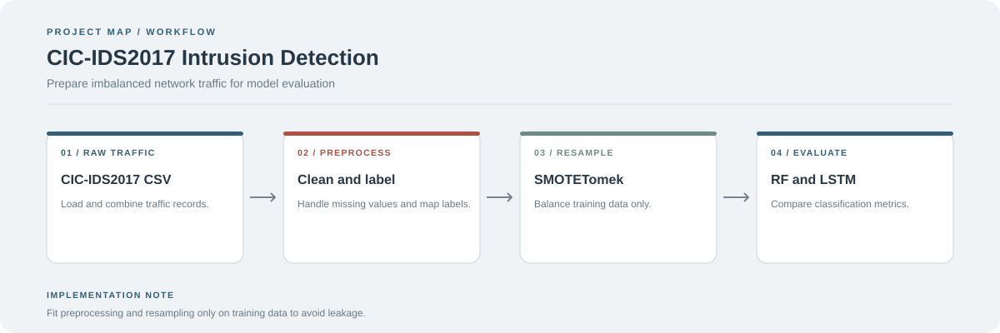

# CIC-IDS2017 Intrusion Detection with SMOTETomek

A notebook project exploring class imbalance in network intrusion detection using CIC-IDS2017, hybrid resampling, and classifier evaluation.

**Stack:** Python, Pandas, scikit-learn, imbalanced-learn, TensorFlow, Jupyter



## Workflow

1. Load and combine the traffic data.
2. Clean column names and handle invalid or missing values.
3. Consolidate attack labels into the classes used by the experiment.
4. Apply SMOTETomek to the training split.
5. Train and compare Random Forest and LSTM models.
6. Review precision, recall, F1-score, confusion matrices, and class distributions.

## Run

```bash
git clone https://github.com/chyk2468/Application-of-the-SMOTETomek-Technique-to-Address-Class-Imbalance-in-the-CIC-IDS2017-Dataset..git
cd Application-of-the-SMOTETomek-Technique-to-Address-Class-Imbalance-in-the-CIC-IDS2017-Dataset.
pip install pandas numpy scikit-learn imbalanced-learn tensorflow jupyter
jupyter notebook smotetomek.ipynb
```

## Files

- `smotetomek.ipynb`: preprocessing, resampling, modelling, and evaluation workflow
- `combined_all.csv`: merged dataset, if included in the checkout

## Evaluation cautions

Keep resampling inside the training split. Never resample the full dataset before splitting, because synthetic samples can leak information into evaluation data. Accuracy alone is not enough for imbalanced classes, so compare per-class recall and F1-score too.
