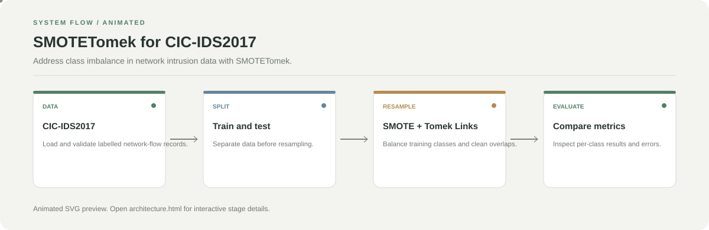

# SMOTETomek for CIC-IDS2017

**Address class imbalance in network intrusion data with SMOTETomek.**

[](https://github.com/chyk2468/Application-of-the-SMOTETomek-Technique-to-Address-Class-Imbalance-in-the-CIC-IDS2017-Dataset.)

## 1. Project Title & Tagline

Address class imbalance in network intrusion data with SMOTETomek.

## 2. Problem Statement

Intrusion datasets can contain far fewer examples of some attack classes than others. A classifier may therefore favour common classes and miss rare attacks.

## 3. Project Preview

Add a real screenshot or before/after comparison after running the project. Include the input and output with the same crop and scale where applicable.

[Open interactive architecture](architecture.html)

## 4. Overview

The project follows a reproducible pipeline from input data through its main processing step to an output that can be inspected and evaluated.

## 5. Key Features

- Load and prepare CIC-IDS2017 features.
- Inspect class distribution before resampling.
- Apply SMOTETomek to training data.
- Compare model metrics before and after resampling.

## 6. Architecture / Workflow



Open the [interactive architecture explorer](architecture.html) to select a stage and read its role.

## 7. Tech Stack

Python, Pandas, NumPy, imbalanced-learn, scikit-learn, and the CIC-IDS2017 dataset

## 8. Installation & Setup

```bash
git clone https://github.com/chyk2468/Application-of-the-SMOTETomek-Technique-to-Address-Class-Imbalance-in-the-CIC-IDS2017-Dataset..git
cd Application-of-the-SMOTETomek-Technique-to-Address-Class-Imbalance-in-the-CIC-IDS2017-Dataset.
```

Install the notebook's Python dependencies and configure the dataset path.

## 9. Usage

Run the notebook or script in order. Split the dataset before applying SMOTETomek, fit resampling only on training data, then compare precision, recall, F1-score, and confusion matrices on untouched test data.

## 10. Project Structure

Inspect the notebook or primary script, data preparation steps, resampling code, model training, and evaluation outputs.

## 11. Results & Demo

Report the original and resampled class counts plus macro-F1, per-class recall, and confusion matrices. Do not claim improvement without a reproducible test-set comparison.

## 12. Future Enhancements

- Compare multiple classifiers and resampling methods.
- Use macro-F1 and per-class recall alongside accuracy.
- Add reproducible splits and random seeds.
- Check for data leakage and duplicate records.

## 13. License

Confirm the code and dataset licences before redistributing the dataset or derived artifacts.
